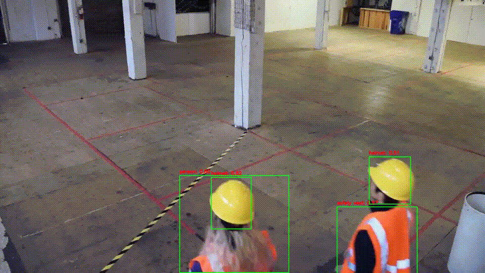
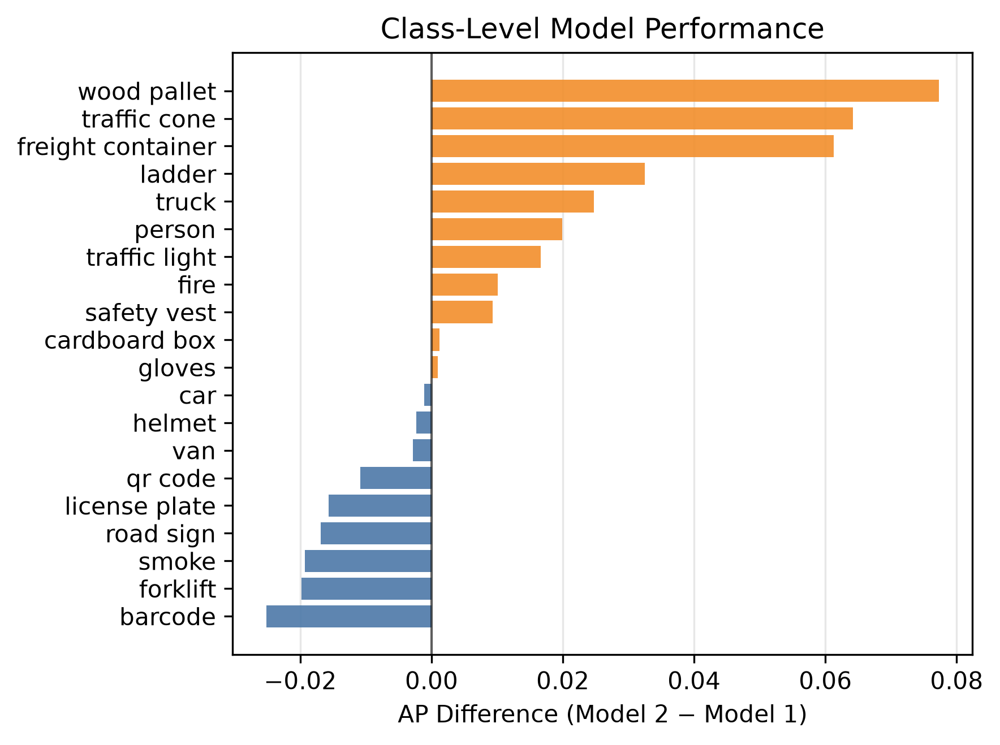
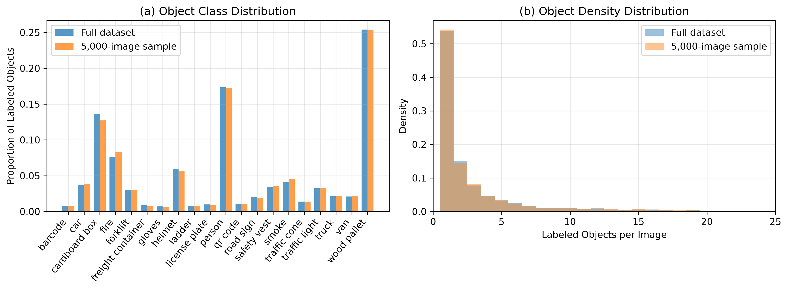
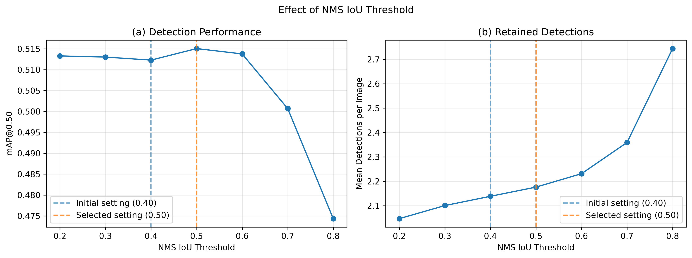
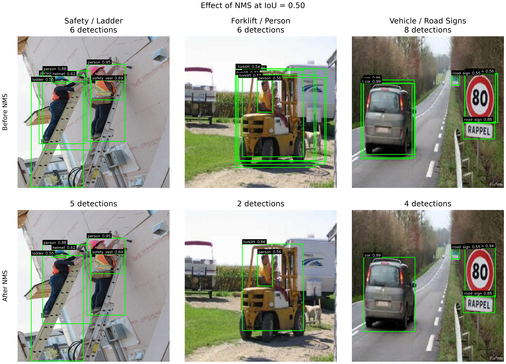
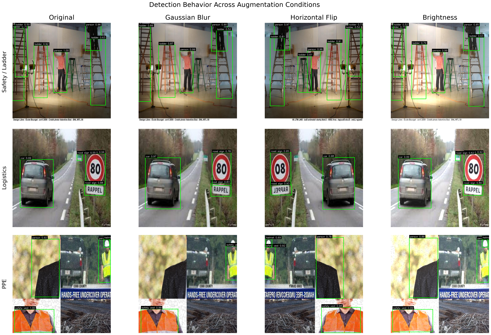
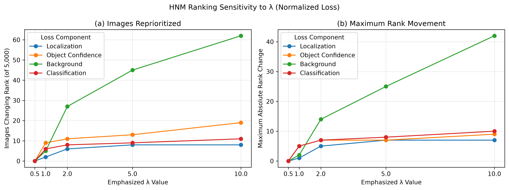
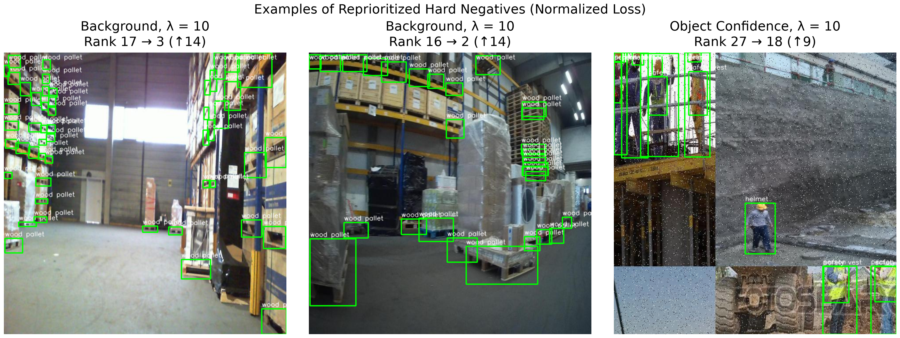

# TechTrack: Evaluation and Deployment Design of a Real-Time Object Detection System

**Lauryn Davis**  
*EN.705.603 Creating AI-Enabled Systems*  
*Johns Hopkins University*  
*Fall 2026*

---

## Abstract

Real-time computer vision systems require more than selecting an accurate model. A model must also perform reliably on representative data and operate effectively within the larger inference and deployment pipeline. This case study evaluates **TechTrack**, a real-time object detection system for logistics imagery and video.

The analysis compares two trained model variants and evaluates several decisions that affect the larger system, including representative dataset sampling, non-maximum suppression (NMS), robustness to changes in visual inputs, and hard-negative mining (HNM). Model 2 is ultimately selected as the primary detector, with an NMS IoU threshold of 0.50. The results also show why aggregate model performance should be considered alongside class-level behavior and sensitivity to changing input conditions. Together, these experiments connect offline model evaluation with the broader engineering decisions required to deploy and maintain a computer vision system.

---

## 1. Introduction

Object detection extends traditional image classification by requiring a model to determine both **what objects are present and where they are located within an image**. This combination of classification and localization supports applications such as industrial monitoring and video analytics, where multiple objects may need to be identified within a single frame.

Object detection architectures generally follow either two-stage or single-stage approaches. Two-stage approaches, including the R-CNN family, first identify candidate regions before classifying and refining the objects within them [[1]](#ref-1). Single-stage detectors instead generate object predictions within a unified inference process. The original *You Only Look Once* (YOLO) framework demonstrated this approach [[2]](#ref-2), while later YOLO architectures continued to emphasize the balance between detection accuracy and computational efficiency [[3]](#ref-3).

TechTrack uses a compact YOLOv4-Tiny detector within a video inference pipeline. Rather than focusing only on the underlying model, this case study examines five system design questions:

- How do the available model variants differ in overall and class-level detection performance?
- Can a smaller image sample preserve the characteristics of the full evaluation dataset?
- How does the NMS threshold affect final detections?
- How sensitive is the selected model to changes in visual input conditions?
- How can hard-negative mining identify and prioritize difficult examples?

Together, these questions provide the structure for evaluating TechTrack as both an object detection model and a larger AI-enabled system.

---

## 2. System Context and Technical Architecture

### 2.1 Computer Vision Task

The TechTrack dataset contains **9,525 labeled images across 20 object classes** associated with logistics and industrial environments [[7]](#ref-7). Images may contain multiple objects, each represented by a class label and ground-truth bounding box. For each image or video frame, the detector generates candidate object locations with objectness and class scores. Confidence filtering and NMS are then used to determine which detections are retained.

The same pipeline can operate on streaming video. Video is transmitted to the inference service over UDP, sampled into frames, and returned with annotated detections. This provides a practical demonstration of how the detector operates beyond static evaluation images.

  

**Figure 1. TechTrack streaming object detection example.** Video transmitted over UDP is processed by the TechTrack inference pipeline and returned with final object detections.

Moving from static images to streaming video introduces engineering considerations that are not captured by offline detection accuracy alone. In a production setting, the rate at which frames are processed would need to be considered alongside inference speed and available computational resources.

---

### 2.2 YOLOv4-Tiny Architecture

TechTrack uses **YOLOv4-Tiny**, a compact single-stage convolutional neural network designed for efficient object detection. The network progressively transforms the 416 × 416 input into learned visual features and produces predictions at two spatial scales.

**Figure 2. Simplified architecture of the TechTrack YOLOv4-Tiny model.** The diagram is derived from the model's Darknet configuration, with intermediate convolutional and routing operations condensed for readability.

---

### 2.3 Inference and Deployment Pipeline

The implemented TechTrack pipeline connects video processing, model inference, and post-processing into the following workflow:

**Video input → frame sampling → YOLOv4-Tiny inference → confidence filtering → NMS → annotated detections**

The application is packaged within a **Docker container**, which provides a consistent environment for the model, application code, and required dependencies. This improves portability and reproducibility across compatible systems. The current implementation demonstrates a functioning inference pipeline, while broader production considerations such as hardware requirements, monitoring, and future model improvement are discussed in **Section 9**.

---

## 3. Evaluation Methodology

### 3.1 Detection Evaluation

Predicted detections are evaluated against ground-truth bounding boxes using **Intersection over Union (IoU)**, a standard measure of spatial overlap in object detection [[4]](#ref-4):

$$IoU = \frac{|B_p \cap B_g|}{|B_p \cup B_g|}$$

Unless otherwise specified, an evaluation threshold of **IoU = 0.50** is used to determine whether a correctly classified prediction sufficiently overlaps a ground-truth object. Predictions are considered in descending confidence order, with each ground-truth object matched to at most one prediction. Additional unmatched detections are treated as false positives.

These matches determine true positives (TP), false positives (FP), and false negatives (FN), which are used to calculate precision and recall:

$$Precision = \frac{TP}{TP + FP}$$

$$Recall = \frac{TP}{TP + FN}$$

Precision and recall provide the basis for the AP and mAP calculations used throughout the analysis.

### 3.2 Average Precision and mAP

Object detection performance is summarized using **Average Precision (AP)** and **mean Average Precision (mAP)**. AP summarizes the precision-recall relationship for an individual class, while mAP averages performance across all object classes [[5]](#ref-5). The TechTrack evaluation uses an 11-point interpolated AP calculation:

$$AP_c = \frac{1}{11} \sum_{r \in \{0,0.1,\ldots,1.0\}} p_{\mathrm{interp},c}(r).$$

Overall performance across the 20 TechTrack classes is then:

$$mAP = \frac{1}{20} \sum_{c=1}^{20} AP_c.$$

Both measures are considered because aggregate mAP can hide differences in performance across individual classes.

### 3.3 Experimental Controls

Each experiment changes the component needed to answer its specific design question while keeping the remaining settings consistent where possible. Model outputs are cached when only downstream evaluation or post-processing changes, and the sampling procedure uses a fixed random seed for reproducibility.

An important distinction is maintained between **evaluation IoU** and **NMS IoU**. Evaluation IoU determines whether a prediction overlaps sufficiently with a ground-truth object to be considered correct, while NMS IoU determines when overlapping predictions should be suppressed as likely duplicates.

---

## 4. Model Performance Comparison

The first design decision was selecting which of the two available model variants should serve as the primary TechTrack detector. Both models were evaluated on the full **9,525-image dataset** under identical conditions. A confidence threshold of **0.50** and NMS IoU threshold of **0.40** were held constant to isolate differences between the two trained models.

### 4.1 Overall Performance

| Model | mAP@0.50 |
| --- | ---: |
| Model 1 | 0.5024 |
| **Model 2** | **0.5126** |

**Table 1. Overall detection performance of the two TechTrack model variants.** Both models were evaluated using the same confidence, NMS, and evaluation settings.

Model 2 achieved the higher overall mAP, improving from **0.5024 to 0.5126**, or approximately **1.02 AP points**. Because the difference is relatively small, class-level performance was also examined before making the final model-selection decision.

### 4.2 Class-Level Performance

  

**Figure 3. Class-level AP difference between Model 2 and Model 1.** Positive values indicate classes where Model 2 achieved higher AP, while negative values indicate classes where Model 1 performed better.

Model 2 achieved higher AP for **11 of the 20 classes**, although the size and direction of the difference varied by object type. Some of the largest improvements occurred for *wood pallet*, *traffic cone*, and *freight container*, while Model 1 retained an advantage for classes including *barcode*, *forklift*, and *smoke*. The overall improvement from Model 2 therefore reflects gains across several classes rather than a uniform improvement across the detection problem.

### 4.3 Design Decision

**Model 2 was selected as the primary detector** because it achieved the higher overall mAP and outperformed Model 1 across a greater number of classes. However, selecting the model with the highest aggregate performance does not guarantee the strongest performance for every object. This would be especially important if particular classes had greater operational importance, so class-level performance should remain part of model monitoring rather than relying only on aggregate mAP.

Model 2 is used for the remaining experiments.

---

## 5. Representative Dataset Sampling

Evaluating every experimental configuration on the full TechTrack dataset can become computationally expensive. The second analysis therefore examined whether a smaller subset could preserve the main characteristics of the complete dataset. Because individual images may contain several object classes, traditional single-label stratification is less straightforward. A reproducible random sample was therefore created and then checked for representativeness.

### 5.1 Sampling Strategy

A subset of **5,000 images** was selected uniformly at random without replacement from the full set of 9,525 images using a fixed random seed of **42**. Representativeness was evaluated using **object class distribution** and **object density per image**. The first measures whether the relative frequency of labeled objects from each class is preserved, while the second measures whether the sample contains a similar number of labeled objects per image.

**Figure 4. Representativeness of the 5,000-image evaluation sample.** The sample is compared with the full TechTrack dataset using object class distribution and labeled objects per image.

### 5.2 Representativeness Analysis

All **20 classes** were represented in the sample. The maximum absolute difference in class proportion was **0.0090**, while the mean absolute difference was **0.0016**. Object density was also similar: the full dataset contained an average of **3.86 objects per image**, compared with **3.79** in the sample, and both datasets had a median of **1 object per image**.

Together, these results suggest that the sample preserves the broad class-distribution and object-density characteristics of the full dataset while reducing the amount of data processed in the remaining experiments.

### 5.3 Design Tradeoff

The 5,000-image subset provides a practical compromise between computational efficiency and evaluation coverage. However, representativeness is demonstrated only for the characteristics measured here and does not guarantee preservation of factors such as scene composition, object co-occurrence, lighting, or image source. The same subset is used for the remaining experiments to maintain consistency across analyses.

---

## 6. Non-Maximum Suppression Threshold Design

NMS removes redundant overlapping predictions after model inference. Its IoU threshold controls how much overlap is tolerated before a lower-confidence detection is suppressed [[6]](#ref-6). Because the appropriate threshold can depend on the model and application, it was evaluated rather than assumed.

### 6.1 Threshold Evaluation

Model 2 was evaluated on the 5,000-image sample across NMS IoU thresholds from **0.20 to 0.80**. The confidence threshold remained fixed at **0.50**, and the same cached predictions were used before NMS so that the experiment specifically measured the effect of changing the suppression threshold.

**Figure 5. Effect of NMS IoU threshold on Model 2 performance.** mAP@0.50 and the average number of retained detections are compared across NMS thresholds from 0.20 to 0.80.

Performance remained relatively stable between approximately **0.20 and 0.60**, with the highest tested mAP occurring at **0.50** at **0.5151**. At thresholds of **0.70 and 0.80**, mAP decreased while the number of retained detections increased. Higher NMS thresholds require greater overlap before a prediction is removed, allowing more potentially redundant detections to remain.

### 6.2 Qualitative Effect of NMS

**Figure 6. Example detections before and after NMS at an IoU threshold of 0.50.** The top row shows candidate detections before suppression, while the bottom row shows the predictions retained after NMS.

The examples show how NMS reduces overlapping predictions and converts the model's initial candidates into a smaller set of final detections.

### 6.3 Design Decision

An NMS IoU threshold of **0.50** was selected because it produced the highest mAP among the tested settings. Performance was relatively stable across nearby thresholds, so 0.50 should be interpreted as the best setting **among those evaluated in this experiment**, rather than as a universally optimal value.

---

## 7. Robustness to Image Transformations

Images encountered after deployment may not always look the same as the data used for evaluation. The fourth analysis therefore tested how Model 2 responds when several controlled transformations are applied to its input images.

### 7.1 Robustness Evaluation

Using the 5,000-image sample, Model 2 was tested under four independent conditions: the original images, **Gaussian blur (5 × 5 kernel)**, **horizontal flipping**, and **increased brightness (α = 1.2, β = 25)**. The confidence and NMS thresholds remained fixed at **0.50**. For horizontally flipped images, the ground-truth bounding boxes were also transformed so that predictions could still be evaluated against the correct object locations.

**Figure 7. Model 2 performance under controlled image transformations.** Overall mAP@0.50 is compared across the original-image baseline, Gaussian blur, horizontal flip, and increased brightness conditions.

Overall performance remained relatively stable. The original images produced an mAP of **0.5151**, compared with **0.5195** under Gaussian blur, **0.5116** under horizontal flipping, and **0.5117** under increased brightness. Class-level effects were larger than the aggregate changes; for example, blur improved AP for *cardboard box* and *forklift* while reducing it for *freight container* and *barcode*. This shows that stable overall mAP can still hide sensitivity within individual classes.

### 7.2 Qualitative Examples

**Figure 8. Examples of image transformations used for robustness evaluation.** Representative images are shown under the Gaussian blur, horizontal flip, and brightness conditions.

The transformations test different properties of the input: blur reduces fine detail, flipping changes spatial orientation, and brightness changes image intensity. Testing them independently makes their effects on model performance easier to interpret.

### 7.3 Design Implication

Model 2 was relatively stable under the **specific transformations and intensities tested**, although the class-level results show greater sensitivity than aggregate mAP alone. These transformations are used only to evaluate the already-trained model and are not part of the deployed TechTrack inference pipeline.

---

## 8. Hard-Negative Mining and Error Prioritization

The final analysis examines **hard-negative mining (HNM)** as a way to identify examples that are particularly difficult for the model. Rather than treating all images equally, HNM uses model loss to rank examples and identify those that create the greatest difficulty for the detector.

### 8.1 Loss-Based Ranking

For each image, the HNM framework combines four error components: **localization, object confidence, background, and classification**:

$$
L_{\text{total}} =
\lambda_{\text{loc}}\frac{L_{\text{loc}}}{s_{\text{loc}}} +
\lambda_{\text{obj}}\frac{L_{\text{obj}}}{s_{\text{obj}}} +
\lambda_{\text{noobj}}\frac{L_{\text{noobj}}}{s_{\text{noobj}}} +
\lambda_{\text{class}}\frac{L_{\text{class}}}{s_{\text{class}}}
$$

The λ parameters determine how strongly each error contributes to total loss [[6]](#ref-6). Localization represents bounding-box error, object confidence measures confidence error for matched objects, background penalizes object confidence without a matched object, and classification represents error in class scores. To reduce differences in numerical scale, each component is normalized by its maximum observed loss ($s$) across the evaluation sample before applying the λ weights.

### 8.2 Lambda Sensitivity

Loss was calculated for all **5,000 images**, with each component normalized using a fixed scaling factor. The images were ranked under different λ configurations, and the **top 100 highest-loss images** were tracked to determine whether changing the weights altered which images were selected as the hardest examples.

**Figure 9. Sensitivity of hard-negative rankings to normalized loss-component weighting.** The plot shows how many of the 5,000 evaluated images change rank and the maximum rank movement when localization, object-confidence, background, or classification loss receives greater weight.

The same 100 images remained in the top-100 set across the tested configurations, but their ordering changed. At λ = 10, background weighting affected **62 images (1.24%)** and produced a maximum rank shift of **42 positions**, while the other components produced smaller changes. Background loss was nonzero across all 5,000 images, compared with only 15 images for each of the other components, helping explain the limited overall ranking sensitivity.

### 8.3 Qualitative Hard-Negative Analysis

**Figure 10. Representative hard-negative examples reprioritized by normalized component-specific λ weighting.** Two background-weighted examples and one object-confidence-weighted example illustrate how emphasizing different loss components changes the ranking of difficult images.

Different components bring attention to different aspects of model difficulty. Background weighting produced the largest observed rank movements, while object-confidence weighting also reprioritized difficult images. The selected examples illustrate how different loss components influence the ordering of hard negatives.

### 8.4 Design Implication

The results suggest that the model has a relatively stable group of difficult images at the top-100 cutoff, while λ still changes how those images are prioritized. Normalization makes the component scales more comparable but does not eliminate differences in their distributions. In this analysis, HNM is used only to identify and rank difficult examples; it does **not** retrain or modify Model 2.

---

## 9. Integrated System Design and Deployment Considerations

The experiments establish an evidence-based configuration for TechTrack, but offline detection performance represents only one part of a deployable computer vision system. In practice, model performance must also be considered alongside the purpose of the application, available computational resources, and how the system will be monitored as new data is introduced.

### 9.1 Application and Engineering Tradeoffs

The observed mAP should not be interpreted as universally sufficient or insufficient. Acceptable performance depends on how detections will be used and on the consequences of different errors. For example, a warehouse activity-monitoring system may tolerate missed detections differently from a safety application. A production system would therefore need to balance detection performance with false-positive and false-negative costs, processing speed, and available computing resources.

The detections could also support decisions beyond the computer vision system itself. For example, counts of pallets or freight containers over time could become inputs to an operational dashboard or planning model. The value of the detector therefore depends not only on how accurately it identifies objects, but also on how those detections are ultimately used.

### 9.2 Deployment and Compute

The Dockerized TechTrack implementation packages the model, application code, and required dependencies into a consistent environment. Depending on the application, the container could run on local infrastructure, hardware located close to the cameras, or cloud infrastructure.

CPU inference may be sufficient when only selected frames or a smaller number of video streams are processed, while higher frame rates or larger workloads could make GPU acceleration more appropriate. The current implementation demonstrates a functioning streaming pipeline but does not establish a specific real-time performance level. Latency, throughput, and resource usage would therefore need to be benchmarked on the intended hardware before deployment.

### 9.3 Monitoring and Future Development

Production monitoring should evaluate both system performance and changes in incoming data. Shifts in camera conditions, lighting, environments, or object distributions could indicate **data or model drift**, while class-level monitoring could reveal degradation hidden by aggregate metrics.

The experiments also identify several opportunities for future development. The confidence threshold could be tuned rather than held fixed, and class-aware or alternative NMS approaches could be evaluated. Robustness testing could be expanded to additional transformations and intensities, with realistic transformations potentially incorporated as training augmentation during future retraining. HNM could similarly prioritize difficult production examples for review or future training data. A revised model could then be reevaluated before deployment. This retraining loop is **not implemented in the current TechTrack system**, but the current robustness and HNM analyses provide tools that could support it.

Together, these steps would extend TechTrack from the current inference pipeline toward a broader AI engineering lifecycle connecting deployment, monitoring, and model improvement.

---

## 10. Conclusion

Overall, the TechTrack case study shows how the performance of a computer vision model is shaped by decisions made throughout the larger system. The experiments provided evidence for the selected model and NMS configuration while also examining representative evaluation data, robustness, and difficult examples. Together with the functioning inference pipeline, these results provide a foundation for continuing to evaluate and improve TechTrack as it moves toward a production computer vision system.

---

## References

[1] S. Ren, K. He, R. Girshick, and J. Sun, “Faster R-CNN: Towards Real-Time Object Detection with Region Proposal Networks,” *Advances in Neural Information Processing Systems (NeurIPS)*, vol. 28, 2015.

[2] J. Redmon, S. Divvala, R. Girshick, and A. Farhadi, “You Only Look Once: Unified, Real-Time Object Detection,” *Proceedings of the IEEE Conference on Computer Vision and Pattern Recognition (CVPR)*, pp. 779–788, 2016. doi: 10.1109/CVPR.2016.91.

[3] A. Bochkovskiy, C.-Y. Wang, and H.-Y. M. Liao, “YOLOv4: Optimal Speed and Accuracy of Object Detection,” *arXiv preprint arXiv:2004.10934*, 2020.

[4] H. Rezatofighi, N. Tsoi, J. Gwak, A. Sadeghian, I. Reid, and S. Savarese, “Generalized Intersection Over Union: A Metric and a Loss for Bounding Box Regression,” *Proceedings of the IEEE/CVF Conference on Computer Vision and Pattern Recognition (CVPR)*, pp. 658–666, 2019. doi: 10.1109/CVPR.2019.00075.

[5] K. Oksuz, B. C. Cam, E. Akbas, and S. Kalkan, “Localization Recall Precision (LRP): A New Performance Metric for Object Detection,” *Proceedings of the European Conference on Computer Vision (ECCV)*, pp. 504–519, 2018.

[6] V. Pulido, “Object Detection System Models,” *EN.705.603 Creating AI-Enabled Systems*, Johns Hopkins University, course lecture, 2026.

[7] Johns Hopkins University, Whiting School of Engineering, *TechTrack*, unpublished course dataset, EN.705.603 Creating AI-Enabled Systems, 2026.