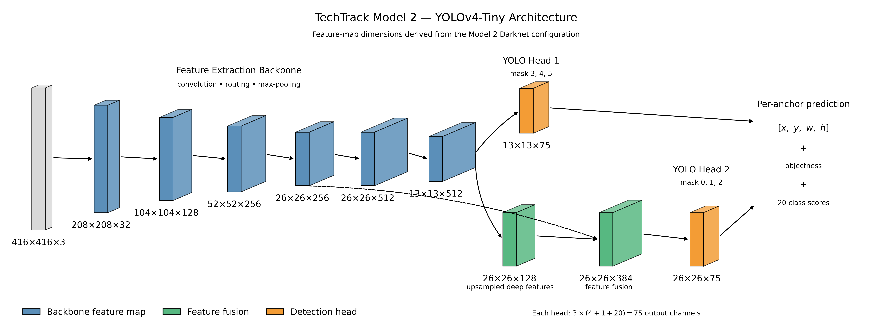
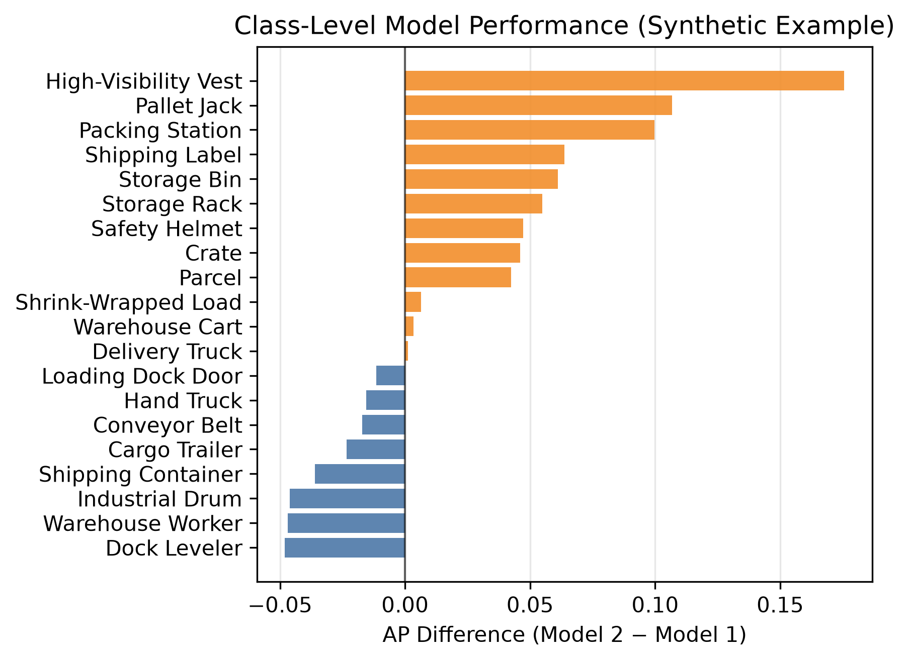
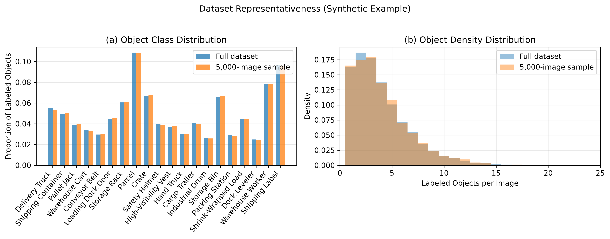
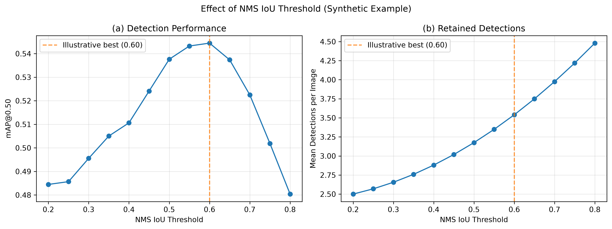
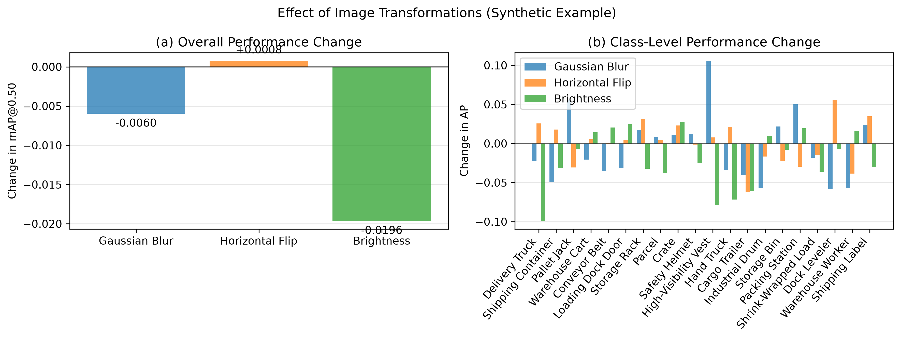
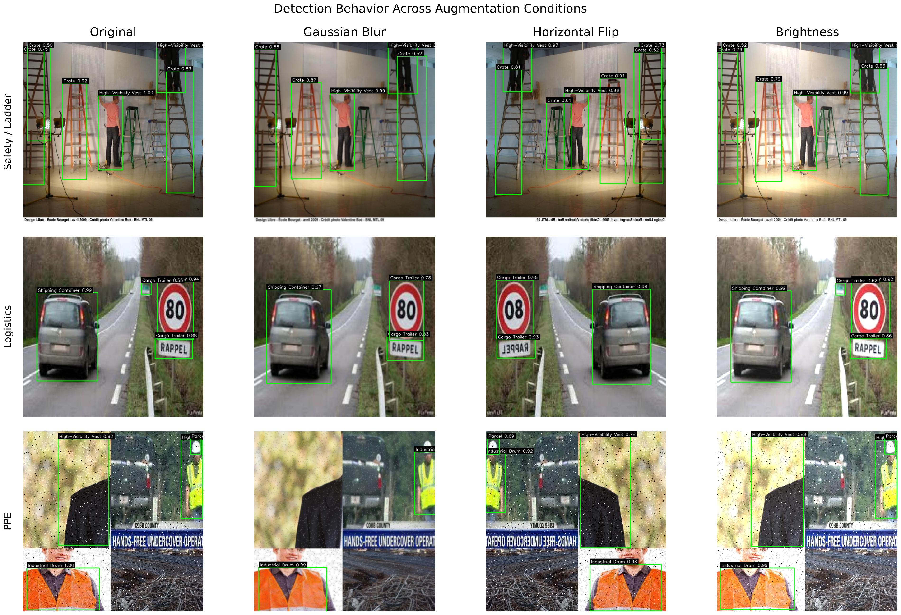
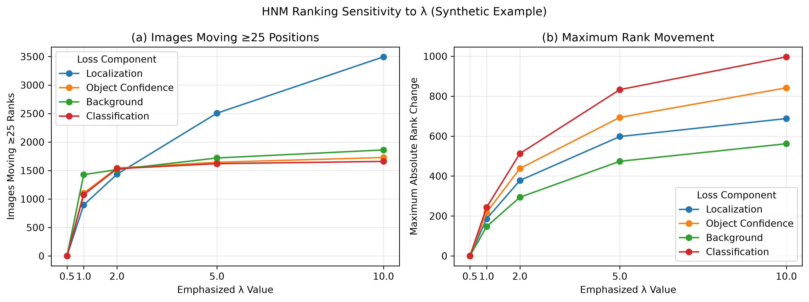

# Warehouse Object Detection: Evaluation and Deployment Design of a Real-Time Computer Vision System

**Lauryn Davis**  
*Graduate Computer Vision Case Study | Fall 2026*

---

## Abstract

Real-time computer vision systems require more than selecting an accurate model. A model must also perform reliably on representative data and operate effectively within the larger inference and deployment pipeline. This case study examines a real-time object detection system using YOLOv4-Tiny to identify objects in warehouse and industrial imagery and video.

The analysis explores several decisions that influence system performance, including model selection, representative dataset sampling, non-maximum suppression (NMS), robustness to changes in visual inputs, and hard-negative mining (HNM). Synthetic results are used to illustrate the evaluation methodology and design tradeoffs without disclosing the original experimental findings, in accordance with graduate coursework sharing guidelines. Together, these analyses connect offline model evaluation with the broader engineering considerations required to develop reliable and maintainable computer vision systems.

## 1. Introduction

Object detection extends traditional image classification by requiring a model to determine both **what objects are present and where they are located within an image**. This combination of classification and localization supports applications such as industrial monitoring and video analytics, where multiple objects may need to be identified within a single frame.

Object detection architectures generally follow either two-stage or single-stage approaches. Two-stage approaches, including the R-CNN family, first identify candidate regions before classifying and refining the objects within them [[1]](#ref-1). Single-stage detectors instead generate object predictions within a unified inference process. The original **You Only Look Once** (YOLO) framework demonstrated this approach [[2]](#ref-2), while later YOLO architectures continued to emphasize the balance between detection accuracy and computational efficiency [[3]](#ref-3).

The system uses a compact YOLOv4-Tiny detector within a video inference pipeline. Rather than focusing only on the underlying model, this case study examines five system design questions:

- How do the available model variants differ in overall and class-level detection performance?
- Can a smaller image sample preserve the characteristics of the full evaluation dataset?
- How does the NMS threshold affect final detections?
- How sensitive is the selected model to changes in visual input conditions?
- How can hard-negative mining identify and prioritize difficult examples?

Together, these questions provide the structure for evaluating both the object detection model and the larger AI-enabled system.

## 2. System Context and Technical Architecture

### 2.1 Computer Vision Task

The evaluation dataset contains **9,525 labeled images across 20 object classes** [[6]](#ref-6). Images may contain multiple objects, each represented by a class label and ground-truth bounding box. For each image or video frame, the detector generates candidate object locations with objectness and class scores. Confidence filtering and NMS are then used to determine which detections are retained.

The same pipeline can operate on streaming video. Video is transmitted to the inference service over UDP, sampled into frames, and returned with annotated detections. This provides a practical demonstration of how the detector operates beyond static evaluation images.

  

**Figure 1. Warehouse object detection using a streaming inference pipeline.** Video transmitted over UDP is processed by the object detection inference pipeline and returned with final object detections [[7]](#ref-7).

Moving from static images to streaming video introduces engineering considerations that are not captured by offline detection accuracy alone. In a production setting, the rate at which frames are processed would need to be considered alongside inference speed and available computational resources.

### 2.2 YOLOv4-Tiny Architecture

The system uses **YOLOv4-Tiny**, a compact single-stage convolutional neural network designed for efficient object detection. The network progressively transforms the 416 × 416 input into learned visual features and produces predictions at two spatial scales.

**Figure 2. Simplified architecture of the YOLOv4-Tiny object detection model.** The diagram is derived from the model's Darknet configuration, with intermediate convolutional and routing operations condensed for readability.

### 2.3 Inference and Deployment Pipeline

At a conceptual level, the object detection pipeline connects video processing, model inference, and post-processing into the following workflow:

**Video input → frame sampling → YOLOv4-Tiny inference → confidence filtering → NMS → annotated detections**

The application is packaged within a **Docker container**, which provides a consistent environment for the model, application code, and required dependencies. This improves portability and reproducibility across compatible systems. The current implementation demonstrates a functioning inference pipeline, while broader production considerations such as hardware requirements, monitoring, and future model improvement are discussed in **Section 9**.

## 3. Evaluation Methodology

### 3.1 Detection Evaluation

Predicted detections are evaluated against ground-truth bounding boxes using **Intersection over Union (IoU)**, a standard measure of spatial overlap in object detection [[4]](#ref-4):

$$IoU = \frac{|B_p \cap B_g|}{|B_p \cup B_g|}$$

An evaluation threshold of **IoU = 0.50** is commonly used to determine whether a correctly classified prediction sufficiently overlaps a ground-truth object. Predictions are considered in descending confidence order, with each ground-truth object matched to at most one prediction. Additional unmatched detections are treated as false positives.

These matches determine true positives (TP), false positives (FP), and false negatives (FN), which are used to calculate precision and recall:

$$Precision = \frac{TP}{TP + FP}$$

$$Recall = \frac{TP}{TP + FN}$$

Precision and recall provide the basis for the AP and mAP calculations used throughout the analysis.

### 3.2 Average Precision and mAP

Object detection performance is summarized using **Average Precision (AP)** and **mean Average Precision (mAP)**. AP summarizes the precision-recall relationship for an individual class, while mAP averages performance across all object classes [[5]](#ref-5). AP can be calculated using 11-point interpolation over predefined recall levels:

$$AP_c = \frac{1}{11} \sum_{r \in \{0,0.1,\ldots,1.0\}} p_{\mathrm{interp},c}(r).$$

Overall performance across $C$ evaluated classes is then:

$$mAP = \frac{1}{20} \sum_{c=1}^{20} AP_c.$$

Both measures are considered because aggregate mAP can hide differences in performance across individual classes.

### 3.3 Experimental Controls

Each experiment changes the component needed to answer its specific design question while keeping the remaining settings consistent where possible. Model outputs are cached when only downstream evaluation or post-processing changes, and sampling procedures can use a fixed random seed for reproducibility.

An important distinction is maintained between **evaluation IoU** and **NMS IoU**. Evaluation IoU determines whether a prediction overlaps sufficiently with a ground-truth object to be considered correct, while NMS IoU determines when overlapping predictions should be suppressed as likely duplicates.

## 4. Model Performance Comparison

The first design decision was selecting which of two available model variants should serve as the primary detector. Both models were evaluated under consistent conditions to isolate differences between the trained models. 

### 4.1 Overall Performance

Object detection performance can be compared using mAP, but a relatively small difference in aggregate performance may not establish which model is most appropriate for a particular application. Class-level performance should also be examined before making a model-selection decision.

| Model | mAP@0.50 |
| --- | ---: |
| Model 1 | 0.55 |
| **Model 2** | **0.565** |

**Table 1. Illustrative overall detection performance of two hypothetical warehouse object detection models.** Values represent synthetic mAP@0.50 scores and do not correspond to empirical model performance.

The synthetic example illustrates how an aggregate performance comparison can be complemented by examining individual object categories.

  

**Figure 3. Illustrative class-level AP differences between two hypothetical warehouse object detection models.** Positive values favor Model 2, while negative values favor Model 1.

### 4.2 Class-Level Performance

Class-level comparisons reveal whether aggregate improvement reflects gains across several classes or a more uneven pattern of performance. A model with higher overall mAP does not necessarily outperform another model for every object type.

### 4.3 Design Decision

Selecting the model with the highest aggregate performance does not guarantee the strongest performance for every object. This would be especially important if particular classes had greater operational importance, so class-level performance should remain part of model monitoring rather than relying only on aggregate mAP.

## 5. Representative Dataset Sampling

Evaluating every experimental configuration on a full dataset can become computationally expensive. The second analysis therefore examined whether a smaller subset could preserve the main characteristics of the complete dataset. Because individual images may contain several object classes, traditional single-label stratification is less straightforward. A reproducible random sample can instead be checked for representativeness.

### 5.1 Sampling Strategy

Representativeness can be evaluated using **object class distribution** and **object density per image**. The first measures whether the relative frequency of labeled objects from each class is preserved, while the second measures whether the sample contains a similar number of labeled objects per image.

**Figure 4. Illustrative representativeness of a randomly sampled warehouse object detection dataset using synthetic data.** Object class proportions and labeled objects per image are compared between a hypothetical full dataset and its random sample.

### 5.2 Representativeness Analysis

Comparing class proportions and object density helps determine whether a subset preserves broad dataset characteristics while reducing the amount of data processed in subsequent experiments. However, similarity on these measures does not guarantee representativeness across other dimensions.

### 5.3 Design Tradeoff

A smaller subset provides a practical compromise between computational efficiency and evaluation coverage. However, representativeness is demonstrated only for the characteristics measured and does not guarantee preservation of factors such as scene composition, object co-occurrence, lighting, or image source. Consistent sampling across analyses also helps maintain comparability.

## 6. Non-Maximum Suppression Threshold Design

NMS removes redundant overlapping predictions after model inference. Its IoU threshold controls how much overlap is tolerated before a lower-confidence detection is suppressed. Because the appropriate threshold can depend on the model and application, it should be evaluated rather than assumed.

### 6.1 Threshold Evaluation

A threshold sensitivity analysis can vary NMS IoU while holding the confidence threshold and model predictions constant. This isolates the effect of changing the suppression threshold. Higher NMS thresholds require greater overlap before a prediction is removed, allowing more potentially redundant detections to remain.

**Figure 5. Illustrative effect of NMS IoU threshold on object detection performance using synthetic data.** Hypothetical mAP@0.50 and mean retained detections are shown across NMS thresholds. The marked illustrative best threshold is not an empirically selected system configuration.

### 6.2 Qualitative Effect of NMS

**Figure 6. Example detections before and after NMS.** The top row shows candidate detections before suppression, while the bottom row shows the predictions retained after NMS. 

The examples show how NMS reduces overlapping predictions and converts the model's initial candidates into a smaller set of final detections.

### 6.3 Design Decision

The appropriate NMS threshold depends on the balance between duplicate suppression and retaining nearby objects. A setting selected from a tested range should be interpreted as the best setting **among those evaluated in that experiment**, rather than as a universally optimal value.

## 7. Robustness to Image Transformations

Images encountered after deployment may not always look the same as the data used for evaluation. The fourth analysis therefore considered how a detector responds when controlled transformations are applied to its input images.

### 7.1 Robustness Evaluation

Common robustness tests include **Gaussian blur**, **horizontal flipping**, and **changes in brightness**. For horizontally flipped images, the ground-truth bounding boxes must also be transformed so that predictions can still be evaluated against the correct object locations.

**Figure 7. Illustrative effect of image transformations on a hypothetical warehouse object detection model using synthetic performance data.** Overall changes in mAP@0.50 are compared with class-level AP changes under Gaussian blur, horizontal flipping, and increased brightness.

Overall performance can remain relatively stable while class-level effects differ. This illustrates why aggregate mAP alone may hide sensitivity within individual classes.

### 7.2 Qualitative Examples

**Figure 8. Examples of image transformations used for robustness evaluation.** Representative images are shown under blur, horizontal flip, and brightness conditions. 

The transformations test different properties of the input: blur reduces fine detail, flipping changes spatial orientation, and brightness changes image intensity. Testing them independently makes their effects on model performance easier to interpret.

### 7.3 Design Implication

Robustness conclusions should be limited to the **specific transformations and intensities tested**. Testing transformations on an already-trained model is also distinct from incorporating those transformations as training augmentation.

## 8. Hard-Negative Mining and Error Prioritization

The final analysis examines **hard-negative mining (HNM)** as a way to identify examples that are particularly difficult for the model. Rather than treating all images equally, HNM uses model loss to rank examples and identify those that create the greatest difficulty for the detector.

### 8.1 Loss-Based Ranking

For each image, the HNM framework combines four error components: **localization, object confidence, background, and classification**:

$$
L_{\text{total}} =
\lambda_{\text{loc}}\frac{L_{\text{loc}}}{s_{\text{loc}}} +
\lambda_{\text{obj}}\frac{L_{\text{obj}}}{s_{\text{obj}}} +
\lambda_{\text{noobj}}\frac{L_{\text{noobj}}}{s_{\text{noobj}}} +
\lambda_{\text{class}}\frac{L_{\text{class}}}{s_{\text{class}}}
$$

The λ parameters determine how strongly each error contributes to total loss. Localization represents bounding-box error, object confidence measures confidence error for matched objects, background penalizes object confidence without a matched object, and classification represents error in class scores. To reduce differences in numerical scale, each component is normalized by a scaling factor ($s$) before applying the λ weights.

This formulation allows different error types to be emphasized when ranking difficult images. The resulting rankings can then be compared to understand how loss-component weighting influences which examples are prioritized for further review.

### 8.2 Weighting Sensitivity

A sensitivity analysis can examine whether changes in loss-component weighting affect the selection or ordering of difficult images. Ranking stability and top-set overlap provide complementary perspectives: the same examples can remain in a selected set while changing priority within it.

**Figure 9. Illustrative sensitivity of hard-negative rankings to normalized loss-component weighting using synthetic data.** The plots show the number of hypothetical images moving at least 25 ranking positions and the maximum absolute rank movement as individual loss components receive greater weight. 

### 8.3 Qualitative Hard-Negative Analysis

**Figure 10. Representative images illustrating considerations for hard-negative mining in warehouse object detection.** The examples highlight differences in scene composition, object density, and visual complexity that may influence detection difficulty. Ground-truth bounding boxes are shown for reference.

Images containing overlapping objects, varied object scales, or challenging visual conditions may require closer examination during model evaluation. Hard-negative mining provides a systematic approach to prioritizing examples based on model loss, rather than relying on visual complexity alone.

### 8.4 Design Implication

Normalization can make component scales more comparable but does not eliminate differences in their distributions. HNM can be used only to identify and rank difficult examples; it does **not** necessarily retrain or modify a detector. Incorporating selected examples into future training would require a separate model-development and evaluation step.

## 9. Integrated System Design and Deployment Considerations

The evaluation framework supports evidence-based configuration decisions, but offline detection performance represents only one part of a deployable computer vision system. In practice, model performance must also be considered alongside the purpose of the application, available computational resources, and how the system will be monitored as new data is introduced.

### 9.1 Application and Engineering Tradeoffs

A measured mAP should not be interpreted as universally sufficient or insufficient. Acceptable performance depends on how detections will be used and on the consequences of different errors. For example, a warehouse activity-monitoring system may tolerate missed detections differently from a safety application. A production system would therefore need to balance detection performance with false-positive and false-negative costs, processing speed, and available computing resources.

The detections could also support decisions beyond the computer vision system itself. For example, counts of pallets or freight containers over time could become inputs to an operational dashboard or planning model. The value of the detector therefore depends not only on how accurately it identifies objects, but also on how those detections are ultimately used.

### 9.2 Deployment and Compute

Dockerized inference systems can package a model, application code, and required dependencies into a consistent environment. Depending on the application, the container could run on local infrastructure, hardware located close to the cameras, or cloud infrastructure.

CPU inference may be sufficient when only selected frames or a smaller number of video streams are processed, while higher frame rates or larger workloads could make GPU acceleration more appropriate. A functioning streaming pipeline alone does not establish a specific real-time performance level. Latency, throughput, and resource usage would therefore need to be benchmarked on the intended hardware before deployment.

### 9.3 Monitoring and Future Development

Production monitoring should evaluate both system performance and changes in incoming data. Shifts in camera conditions, lighting, environments, or object distributions could indicate **data or model drift**, while class-level monitoring could reveal degradation hidden by aggregate metrics.

Several opportunities remain for future development. The confidence threshold could be tuned rather than held fixed, and class-aware or alternative NMS approaches could be evaluated. Robustness testing could be expanded to additional transformations and intensities, with realistic transformations potentially incorporated as training augmentation during future retraining. HNM could similarly prioritize difficult production examples for review or future training data. A revised model could then be reevaluated before deployment. This retraining loop is not implemented in the current system, but the robustness and HNM analyses provide methods that could support future model improvement.

Together, these steps illustrate how an inference pipeline could be extended toward a broader AI engineering lifecycle connecting deployment, monitoring, and model improvement.

## 10. Conclusion

Overall, this case study demonstrates that developing effective computer vision systems requires more than achieving strong model accuracy. Careful evaluation of data representativeness, post-processing, robustness, and model errors is equally important for understanding how a system performs under different conditions. These findings also highlight the importance of connecting model evaluation with deployment and ongoing monitoring to support reliable performance and practical applications.

## References

[1] S. Ren, K. He, R. Girshick, and J. Sun, “Faster R-CNN: Towards Real-Time Object Detection with Region Proposal Networks,” *Advances in Neural Information Processing Systems (NeurIPS)*, vol. 28, 2015.

[2] J. Redmon, S. Divvala, R. Girshick, and A. Farhadi, “You Only Look Once: Unified, Real-Time Object Detection,” *Proceedings of the IEEE Conference on Computer Vision and Pattern Recognition (CVPR)*, pp. 779–788, 2016. doi: 10.1109/CVPR.2016.91.

[3] A. Bochkovskiy, C.-Y. Wang, and H.-Y. M. Liao, “YOLOv4: Optimal Speed and Accuracy of Object Detection,” *arXiv preprint arXiv:2004.10934*, 2020.

[4] H. Rezatofighi, N. Tsoi, J. Gwak, A. Sadeghian, I. Reid, and S. Savarese, “Generalized Intersection Over Union: A Metric and a Loss for Bounding Box Regression,” *Proceedings of the IEEE/CVF Conference on Computer Vision and Pattern Recognition (CVPR)*, pp. 658–666, 2019. doi: 10.1109/CVPR.2019.00075.

[5] K. Oksuz, B. C. Cam, E. Akbas, and S. Kalkan, “Localization Recall Precision (LRP): A New Performance Metric for Object Detection,” *Proceedings of the European Conference on Computer Vision (ECCV)*, pp. 504–519, 2018.

[6] Roboflow Universe, “Warehouse Computer Vision Datasets and Models,” *Roboflow Universe*. [Online]. Available: https://universe.roboflow.com/browse/logistics/warehouse. Accessed: October 17, 2026.

[7] Intel Corporation, “Safety_Full_Hat_and_Vest.mp4,” *Safety Gear Detector*, 2021. [Online video]. Available: https://github.com/intel-iot-devkit/safety-gear-detector-python/blob/master/resources/Safety_Full_Hat_and_Vest.mp4. BSD 3-Clause License.

