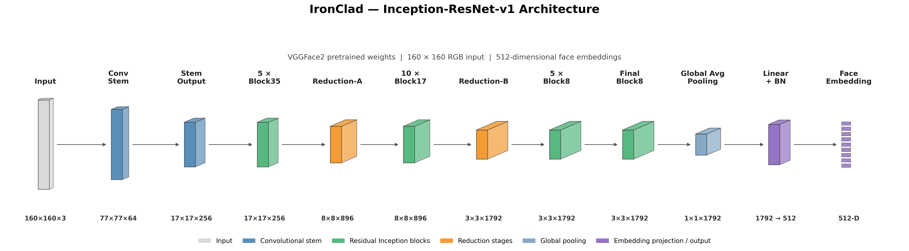
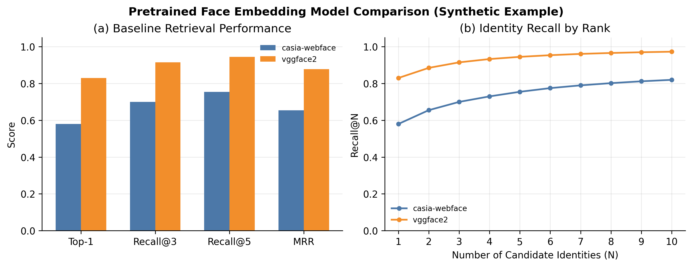
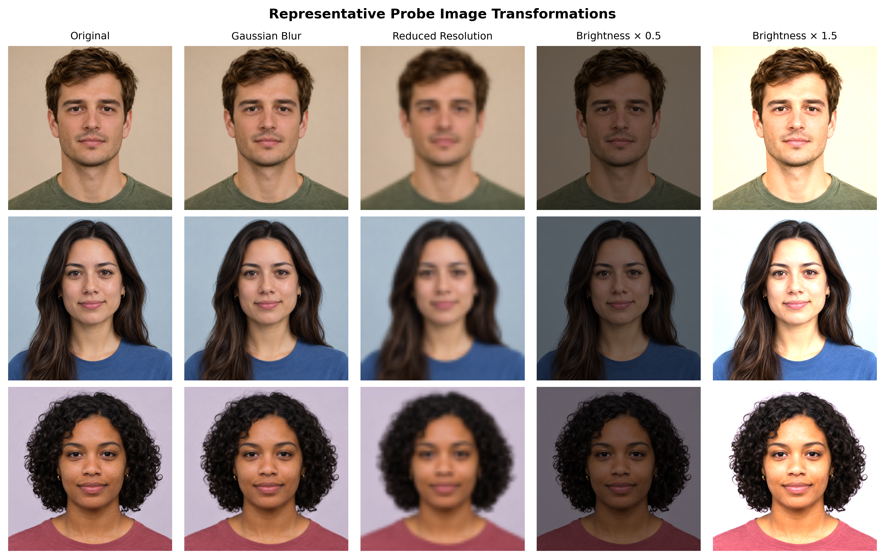
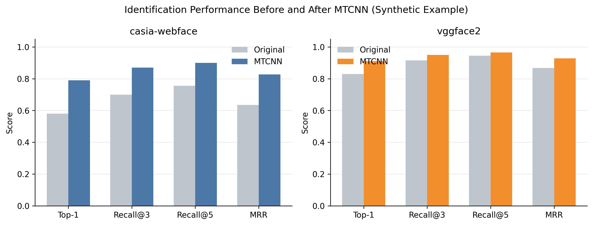
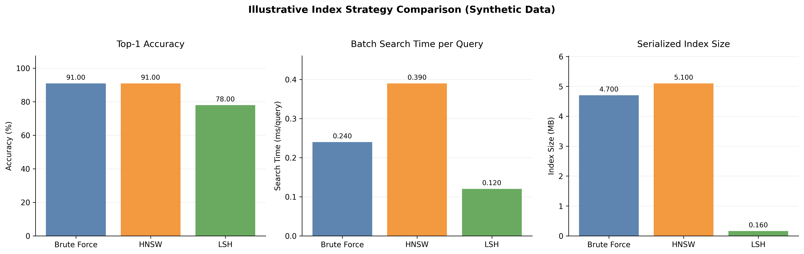
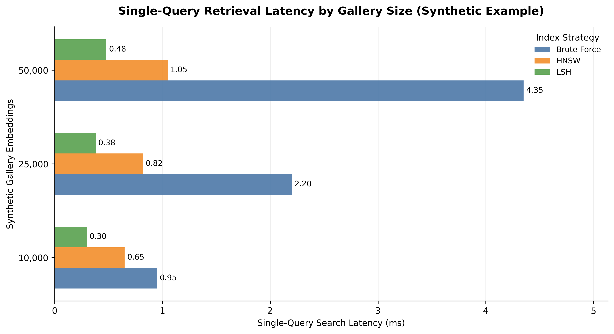
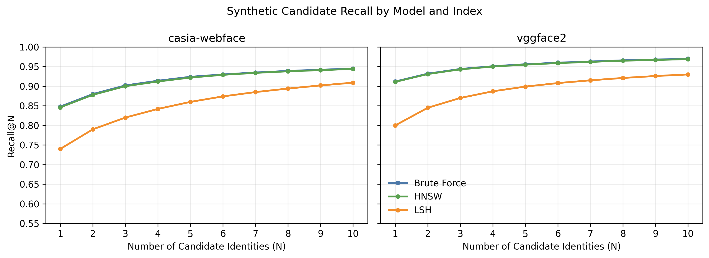
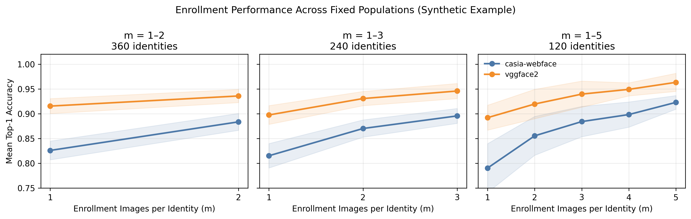

# Embedding-Based Facial Identification: Evaluation and Design of a Vector Retrieval System

Lauryn Davis  
Graduate AI Systems Case Study  
Fall 2026

---

## Abstract

Embedding-based facial identification systems rely on several interconnected components, from facial feature extraction and image preprocessing to vector similarity search. The choice of pretrained model, retrieval strategy, and enrollment approach can influence identification accuracy and efficiency.

This case study evaluates a facial identification system for a hypothetical defense organization responsible for identifying and monitoring thousands of personnel. Five experiments examine model selection, preprocessing, indexing strategies, candidate ranking, and enrollment size. The directional findings favor **VGGFace2-pretrained Inception-ResNet-v1 with MTCNN preprocessing** and exact FAISS nearest-neighbor search. Returning three candidate identities increases identification coverage, while additional enrollment photographs offer potential accuracy improvements.

The public portfolio preserves the experimental methodology and illustrates the observed performance trends using synthetic figures rather than original measurements, in accordance with graduate coursework sharing guidelines.

## 1. Introduction

Traditional computer vision classification models recognize predefined categories, such as different types of objects. Facial identification presents a different challenge because the goal is to recognize specific individuals rather than general categories. For a large organization, the system must also accommodate new personnel without frequent model retraining.

One approach is to use **facial embeddings**, which represent distinguishing facial features as numerical vectors. Rather than predicting an identity from a fixed set of classes, the system compares these vectors against enrolled photographs to find the closest matches. **FaceNet**, introduced by Google researchers, established a method for learning embeddings that place images of the same person closer together [1](#ref-1). This prototype applies that principle using **Inception-ResNet-v1** for feature extraction and **Facebook AI Similarity Search (FAISS)** for vector retrieval [2](#ref-2). New personnel can therefore be enrolled by adding their embeddings to the gallery without retraining the model.

This case study addresses five questions:

1. Which pretrained embedding model provides the strongest identification accuracy?
2. How do face detection and preprocessing affect performance?
3. How do vector indexing strategies compare in accuracy and efficiency?
4. How many potential identity matches should the system return?
5. Does enrolling multiple photographs per individual improve identification?

## 2. System Context and Technical Architecture

### 2.1 Identification Workflow

The prototype uses **closed-set facial identification**, meaning every evaluated person has at least one enrolled photograph. In contrast, **open-set identification** must also determine whether an individual is unknown. Closed-set evaluation provides an initial basis for comparing identification methods, but a deployed security system would need to handle unenrolled individuals.

The identification workflow follows five steps:

**Facial image → MTCNN preprocessing → Inception-ResNet-v1 embedding extraction → FAISS similarity search → Ranked identity matches**

**Multi-task Cascaded Convolutional Networks (MTCNN)** detects and aligns faces using facial landmarks [3](#ref-3). The implementation uses pretrained detection and recognition models from the PyTorch-based `facenet-pytorch` library [4](#ref-4), which provides models originating from an earlier TensorFlow implementation [5](#ref-5). The processed image passes through Inception-ResNet-v1 to produce a 512-dimensional embedding.

During **enrollment**, embeddings and their associated identities are stored in a searchable collection called the **gallery**. During identification, an incoming image called a **probe** is compared against the gallery. The prototype uses exact nearest-neighbor search with Euclidean distance and returns the three closest distinct identities.

### 2.2 Model Architecture and Pretraining

Inception-ResNet-v1 combines **Inception modules** that extract features at different scales with **residual connections** that support deeper network training [6](#ref-6). Figure 1 illustrates the architecture used for embedding extraction.

  

*Figure 1. Simplified Inception-ResNet-v1 architecture showing the convolutional stem, Inception-residual blocks, reduction stages, and final embedding projection.*

The evaluation compares two versions of the same architecture with different pretrained weights:

- **CASIA-WebFace:** Approximately 0.5 million images representing over 10,000 identities [7](#ref-7).
- **VGGFace2:** Approximately 3.3 million images representing over 9,000 identities, with variation in pose, age, and lighting [8](#ref-8).

Comparing these models helps assess how the pretraining dataset influences facial embedding quality without changing the underlying network architecture.

### 2.3 Application Implementation

The prototype uses a Flask application with `/add` and `/identify` endpoints for enrollment and identification. Its FAISS index is maintained in memory, so enrollment records do not persist across application restarts. A production implementation would require persistent storage and index recovery.

## 3. Evaluation Methodology

The evaluation uses **CelebA (CelebFaces Attributes)**, a facial image dataset with identity annotations [9](#ref-9). Labeled photographs are divided into an enrolled **gallery** and a separate set of **probe** images. Every evaluated identity is represented in the gallery.

The public portfolio does not reproduce CelebA photographs or original quantitative results. The figures use hypothetical values to illustrate the evaluation's directional findings.

Three metrics assess identification performance:

**Top-1 Accuracy** measures the proportion of probes for which the first-ranked identity is correct.

$$
\text{Top-1 Accuracy} = \frac{1}{N}\sum_{i=1}^{N}\mathbb{1}(r_i=1)
$$

**Recall@k** measures the proportion of probes for which the correct identity appears among the top $k$ candidates.

$$
\text{Recall@}k = \frac{1}{N}\sum_{i=1}^{N}\mathbb{1}(r_i\leq k)
$$

**Mean Reciprocal Rank (MRR)** rewards systems that place the correct identity higher in the ranking.

$$
\text{MRR} = \frac{1}{N}\sum_{i=1}^{N}\frac{1}{r_i}
$$

Here, $N$ is the number of probes, $r_i$ is the rank of the correct identity, and $\mathbb{1}$ is an indicator function. A correct identity that is not retrieved contributes zero.

The experiments also examine image quality, enrollment availability, retrieval latency, index storage, and scalability.

## 4. Experimental Evaluation

### 4.1 Task 1: Pretrained Face Embedding Model Selection

The first experiment compares CASIA-WebFace and VGGFace2 pretrained models under identical preprocessing and retrieval conditions. Images are resized to 160 × 160 pixels and standardized without MTCNN face detection or alignment. Their embeddings are then compared using exact Euclidean nearest-neighbor search to establish baseline identification performance.

  

*Figure 2. Synthetic baseline comparison of pretrained models using Top-1 accuracy, Recall@k, MRR, and identity recall by rank.*

In the illustrative comparison, VGGFace2 achieves **83% Top-1 accuracy**, compared with **58% for CASIA-WebFace**. Its higher Recall@3 (**91.5%**) and MRR (approximately **0.878**) reflect the directional advantage of VGGFace2 and illustrate how pretraining data can affect identification performance even when the network architecture is unchanged.

The experiment also considers sensitivity to image quality. Probe images are subjected to blur, reduced resolution, and brightness changes while the gallery remains unchanged.

  

*Figure 3. Qualitative illustration of blur, reduced resolution, and brightness changes using AI-generated portraits of fictional individuals [10](#ref-10).*

These transformations demonstrate how image degradation can obscure facial features and affect the consistency of extracted embeddings.

**Design implication:** VGGFace2 is the preferred pretrained model for further evaluation, although the final selection would require validation on representative deployment data.

### 4.2 Task 2: Face Detection and Preprocessing

Task 2 examines whether MTCNN preprocessing improves identification accuracy. Gallery and probe images undergo face detection, alignment, and cropping to 160 × 160 pixels. If detection fails, the original image is resized and standardized as a fallback.

  

*Figure 4. Synthetic identification performance before and after MTCNN preprocessing for both pretrained models.*

The illustrative results show improvements for both models. CASIA-WebFace increases from **58% to 79% Top-1 accuracy**, while VGGFace2 increases from **83% to 91%**. VGGFace2 Recall@3 also rises from **91.5% to 95%**. These trends demonstrate the potential benefit of standardizing facial positioning and reducing irrelevant background content.

An additional experiment applies MTCNN only to incoming probes to examine whether an existing gallery also needs preprocessing. The benefit depends on the consistency and quality of enrolled photographs.

Detection and alignment introduce processing overhead, although gallery images can be prepared once during enrollment. The comparison does not isolate detection, cropping, and alignment individually. Evaluating their individual contributions would require additional experiments.

**Design implication:** Consistent MTCNN preprocessing is a reasonable choice for the proposed pipeline, provided its accuracy benefit justifies the additional processing cost.

### 4.3 Task 3: Vector Indexing and Scalability

Task 3 compares three FAISS indexing strategies using MTCNN-preprocessed VGGFace2 embeddings:

- **Brute Force:** Exact nearest-neighbor search using Euclidean distance.
- **Hierarchical Navigable Small World (HNSW):** Approximate search using a multilayer graph.
- **Locality-Sensitive Hashing (LSH):** Approximate search using binary hashing and Hamming distance.

Each method is configured to index 512-dimensional facial embeddings, with the specific FAISS implementations and parameters summarized below.

| Index | FAISS configuration | Parameters |
|---|---|---|
| Brute Force | `IndexFlatL2` | 512 dimensions; exact squared Euclidean (L2) distance |
| HNSW | `IndexHNSWFlat` | 512 dimensions; L2 distance; `M=32`; `efConstruction=40`; `efSearch=64` |
| LSH | `IndexLSH` | 512 dimensions; `nbits=128`; default rotation and threshold settings; Hamming distance |

To compare retrieval efficiency under consistent conditions, each index retrieves up to 50 nearest embeddings per query. Search times are evaluated across three repetitions using a single FAISS CPU thread.

  

*Figure 5. Synthetic comparison of identification accuracy, batch search latency, and serialized index size.*

In the illustrative gallery comparison, Brute Force and HNSW both achieve **91% Top-1 accuracy**. Brute Force shows a lower batch retrieval latency (**0.24 versus 0.39 ms/query**), while LSH has the smallest illustrated storage footprint and fastest search but lower accuracy (**78%**). These values illustrate the tradeoff between retrieval efficiency and identification quality. With a relatively small evaluation gallery, exact Brute Force search can remain computationally efficient without the additional overhead of graph-based indexing.

To explore scalability, a second illustration compares hypothetical galleries containing **10,000, 25,000, and 50,000 embeddings**.

  

*Figure 6. Simulated single-query retrieval latency across increasing gallery sizes.*

The scaling curves illustrate how Brute Force latency may increase with gallery size while HNSW grows more gradually. Actual performance would depend on hardware, index configuration, and data characteristics.

The illustration also does not establish whether HNSW preserves retrieval accuracy as the gallery grows. This would require measuring nearest-neighbor Recall@k against exact Brute Force results at each gallery size.

At a hypothetical scale of **one billion images**, storing 512-dimensional float32 embeddings alone would require approximately **2.05 TB** in decimal units. Additional storage would be needed for identities, metadata, and index structures.

**Design implication:** Brute Force is a practical choice for the prototype's relatively small gallery, providing exact retrieval with low search latency. HNSW may become preferable as enrollment grows, but its speed and retrieval-recall tradeoffs require benchmarking at representative scales.

### 4.4 Task 4: Candidate Ranking and Retrieval Depth

Task 4 examines how many candidate identities the system should return for human review. Using MTCNN-preprocessed embeddings from Task 2, Recall@N is evaluated for ranked lists containing one through ten distinct identities across both pretrained models and all three indexing strategies.

  

*Figure 7. Synthetic Recall@N across candidate-list sizes for two pretrained models and three indexing strategies using MTCNN-preprocessed embeddings.*

For VGGFace2 with Brute Force, the illustrative comparison shows Recall@1 of approximately **91%**, with Recall@3 approaching **95%**. Larger candidate lists provide smaller gains. Brute Force and HNSW produce similar recall, while LSH benefits more from returning additional candidates.

**Design implication:** Returning **three distinct candidate identities** offers a manageable list for human review while increasing the chance that the correct person is included. It does not improve the first-ranked prediction or independently confirm identity.

### 4.5 Task 5: Optimizing Enrollment Images per Identity

The final experiment examines whether multiple enrollment photographs improve identification by capturing variation in pose, expression, and lighting.

  

*Figure 8. Multiple enrollment photographs illustrating pose, expression, and lighting variation across three AI-generated fictional identities [10](#ref-10).*

Three enrollment configurations are evaluated, allowing up to two, three, or five photographs per person. Because fewer identities have enough available images for larger configurations, each experiment uses a different eligible population. Within each experiment, identities and probe images remain fixed while enrollment photographs are randomly selected across repeated trials.

  

*Figure 9. Synthetic mean Top-1 accuracy across enrollment levels using hypothetical identity populations. Shaded regions represent variability across simulated trials.*

The illustrative results show the largest improvement when a second photograph is added, with Top-1 accuracy increasing by approximately **3–5 percentage points for VGGFace2** and **5 percentage points for CASIA-WebFace**. Additional photographs provide smaller gains, suggesting diminishing returns beyond two or three images. Results should be compared within each panel rather than across different eligible populations.

**Design implication:** Enrolling **two to three varied photographs per person** may balance identification accuracy and enrollment effort while still accommodating individuals with only one available photograph. This recommendation would require validation on representative deployment data.

## 5. System Design and Deployment Considerations

### 5.1 Engineering Trade-offs

The experiments highlight the importance of balancing identification performance with retrieval efficiency and enrollment requirements. Exact search is straightforward for smaller galleries, while approximate indexing may become more attractive as enrollment grows. Candidate ranking and the number of available enrollment photographs also affect how reliably the system can support human identification decisions.

Alternative embedding methods could be evaluated in future iterations. For example, **ArcFace** introduces a training objective designed to improve separation between different identities in embedding space [11](#ref-11). Comparing it with the existing pretrained models could help assess whether a different representation improves identification.

The underlying approach also extends beyond facial recognition. Embedding-based retrieval can support applications such as visual similarity search and semantic document search.

### 5.2 Deployment and Compute

The Flask prototype could be packaged with **Docker** to support consistent deployment across environments. Production use would require persistent enrollment records, reliable index recovery, and controlled access to biometric data.

Compute requirements would depend on the number and frequency of identification requests. CPUs may be sufficient for smaller deployments, while GPUs could support higher inference throughput. Processing images near the camera may also reduce network delays and limit the transmission of raw facial photographs.

These decisions should be evaluated using end-to-end identification latency, including preprocessing, embedding extraction, and retrieval.

### 5.3 Monitoring and Future Development

A deployed system would need ongoing evaluation as personnel and operating conditions change. Camera quality, lighting, and outdated enrollment photographs could affect identification reliability. Testing across demographic groups would also be important for assessing differences in performance.

A key next step is **unknown-person rejection**. Unlike the current closed-set prototype, an open-set system must recognize when a probe does not correspond to an enrolled identity. This would require calibrated similarity thresholds and evaluation of false matches and missed identifications.

Identity matching would also need to remain separate from access authorization. Future development could explore presentation-attack detection to reduce the risk of identification using photographs, videos, or other artificial representations instead of a physically present person.

## 6. Conclusion

This case study demonstrates how pretrained facial embeddings and vector similarity search can support identification without requiring a separate classification model for every enrolled individual. The evaluation highlights the importance of embedding quality, consistent preprocessing, and retrieval design in balancing identification accuracy with computational efficiency.

While the prototype provides a foundation for scalable facial identification, real-world deployment would require further validation under varying image conditions, reliable handling of unknown individuals, and appropriate security and privacy controls.

## References

[1] F. Schroff, D. Kalenichenko, and J. Philbin, “FaceNet: A Unified Embedding for Face Recognition and Clustering,” *Proceedings of the IEEE Conference on Computer Vision and Pattern Recognition (CVPR)*, 2015. https://doi.org/10.1109/CVPR.2015.7298682

[2] M. Douze et al., “The Faiss Library,” arXiv:2401.08281, 2024. https://arxiv.org/abs/2401.08281

[3] K. Zhang, Z. Zhang, Z. Li, and Y. Qiao, “Joint Face Detection and Alignment Using Multitask Cascaded Convolutional Networks,” *IEEE Signal Processing Letters*, vol. 23, no. 10, pp. 1499–1503, 2016. https://doi.org/10.1109/LSP.2016.2603342

[4] timesler, *facenet-pytorch: Pretrained PyTorch Face Detection (MTCNN) and Facial Recognition (InceptionResnet) Models*, GitHub repository. https://github.com/timesler/facenet-pytorch

[5] D. Sandberg, *FaceNet: Face Recognition Using TensorFlow*, GitHub repository. https://github.com/davidsandberg/facenet

[6] C. Szegedy, S. Ioffe, V. Vanhoucke, and A. Alemi, “Inception-v4, Inception-ResNet and the Impact of Residual Connections on Learning,” *Proceedings of the AAAI Conference on Artificial Intelligence*, 2017. https://arxiv.org/abs/1602.07261

[7] D. Yi, Z. Lei, S. Liao, and S. Z. Li, “Learning Face Representation from Scratch,” arXiv:1411.7923, 2014. https://arxiv.org/abs/1411.7923

[8] Q. Cao, L. Shen, W. Xie, O. M. Parkhi, and A. Zisserman, “VGGFace2: A Dataset for Recognising Faces Across Pose and Age,” *Proceedings of the IEEE International Conference on Automatic Face & Gesture Recognition*, 2018. https://doi.org/10.1109/FG.2018.00020

[9] Z. Liu, P. Luo, X. Wang, and X. Tang, “Deep Learning Face Attributes in the Wild,” *Proceedings of the IEEE International Conference on Computer Vision (ICCV)*, 2015. https://mmlab.ie.cuhk.edu.hk/projects/CelebA.html

[10] OpenAI, *Image Generation*, OpenAI API Documentation. https://platform.openai.com/docs/guides/image-generation

[11] J. Deng, J. Guo, N. Xue, and S. Zafeiriou, “ArcFace: Additive Angular Margin Loss for Deep Face Recognition,” *Proceedings of the IEEE/CVF Conference on Computer Vision and Pattern Recognition (CVPR)*, pp. 4690–4699, 2019. https://doi.org/10.1109/CVPR.2019.00482
